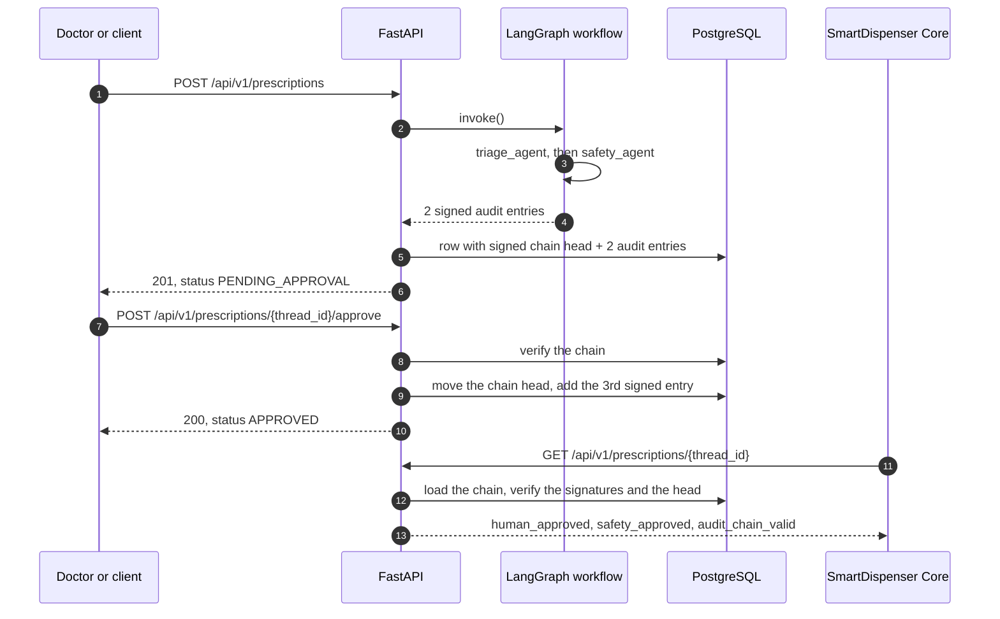

# HealthTech Agent Orchestrator

[](https://github.com/kauan287/healthtech-agent-orchestrator/actions/workflows/ci.yml)
[](https://www.python.org)
[](https://langchain-ai.github.io/langgraph/)
[](https://fastapi.tiangolo.com)
[](LICENSE)

A FastAPI service that reviews prescriptions with two LangGraph agents and a doctor.
A triage agent proposes a medication, a safety agent checks it against the patient's allergies, and the prescription then waits until a doctor approves or rejects it.
Every step is written to an audit chain signed with HMAC-SHA256, and every read verifies that chain.
If someone edits the database by hand, the API withholds the prescription's clinical data and reports `audit_chain_valid: false`, so the companion dispenser refuses to release the medication.
**Live demo.** Interactive API docs at https://healthtech-orchestrator.onrender.com/docs, and the companion dispenser's dashboard at https://smartdispenser-core.onrender.com/dashboard. Both run on Render's free plan, so the first request after 15 idle minutes takes about a minute while the service starts. The data resets on every restart.

The clinical text is in Spanish because the demo targets Spanish-speaking clinics. That covers the prompts, the demo rule table, and the sample requests. Code, API fields, and error messages are in English.



## What this project shows

- Two LangGraph agents behind a `ClinicalModel` protocol (`src/graph.py`, `src/clinical.py`). A deterministic demo model replaces the LLM, so the tests, CI, and `docker compose up` run the real workflow without an API key.
- An HMAC-SHA256 audit chain in about 100 lines (`src/audit.py`). Tests prove that it catches an edited field, a deleted or reordered entry, a rewound head, and a chain copied from another prescription.
- Reads that trust only verified, signed entries (`src/prescription.py`). A tampered prescription comes back as `INVALID` with every clinical field set to null.
- A doctor's decision that is a compare-and-swap on the signed chain head. Of two concurrent decisions, exactly one is recorded, and the tests check that on SQLite and on PostgreSQL.
- CI that runs ruff, `mypy --strict`, and 50 tests on SQLite and PostgreSQL. It then starts the Docker Compose stack, restarts the API while a prescription waits for the doctor, and edits an audit row with `psql` to check that the API reports the tampering.
- A second service in C# that consumes this API. [SmartDispenser Core](https://github.com/kauan287/smartdispenser-core) releases a medication only for an approved prescription whose chain verifies.

## Run it

You need Docker. If you ran an earlier version, delete its database volume first with `docker compose down -v`, because the schema changed and `create_all` does not migrate it.
No API key is required. By default the stack uses `LLM_PROVIDER=demo`, a deterministic rule table that stands in for the LLM.

```bash
git clone https://github.com/kauan287/healthtech-agent-orchestrator.git
cd healthtech-agent-orchestrator
docker compose up --build
```

The API listens on http://localhost:8000, with interactive docs at http://localhost:8000/docs.

Create a prescription. The agents run and the workflow pauses for the doctor:

```bash
curl -s -X POST localhost:8000/api/v1/prescriptions \
	-H 'Content-Type: application/json' \
	-d '{"prescription_id": "RX-001", "patient_symptoms": "Fiebre de 39 °C y dolor articular", "patient_allergies": ["Ibuprofeno"]}'
```

```json
{
  "thread_id": "session-RX-001",
  "prescription_id": "RX-001",
  "status": "PENDING_APPROVAL",
  "proposed_medication": "Paracetamol",
  "dosage": "500 mg cada 8 horas",
  "safety_approved": true,
  "risk_notes": "Sin conflictos con las alergias conocidas.",
  "human_approved": null,
  "doctor_comments": null,
  "is_paused_waiting_approval": true,
  "audit_chain_valid": true
}
```

Record the doctor's decision, then read the signed audit trail:

```bash
curl -s -X POST localhost:8000/api/v1/prescriptions/session-RX-001/approve \
	-H 'Content-Type: application/json' \
	-d '{"approved": true, "doctor_comments": "Paracetamol adecuado."}'

curl -s localhost:8000/api/v1/prescriptions/session-RX-001/audit
```

To see the tamper check work, change a stored entry and read the prescription again:

```bash
docker compose exec postgres psql -U healthtech -d healthtech_db -c \
	"UPDATE audit_logs SET details = replace(details, 'Paracetamol', 'Morfina')"

curl -s localhost:8000/api/v1/prescriptions/session-RX-001/audit
# {"valid": false, "detail": "Entry 0 (TRIAGE_AGENT) was modified after it was signed.", ...}

curl -s localhost:8000/api/v1/prescriptions/session-RX-001
# "status": "INVALID", "audit_chain_valid": false, and every clinical field is null
```

To use real LLM agents, get a free key at https://console.groq.com/keys and start the stack with it:

```bash
LLM_PROVIDER=groq GROQ_API_KEY=gsk_... docker compose up --build
```

### Run it without Docker

```bash
uv sync
cp .env.example .env
uv run uvicorn src.server:app --reload
```

Local runs use SQLite (`healthtech.db`). Without a `.env` file, the app uses its production defaults, `LLM_PROVIDER=groq` and `ENVIRONMENT=production`. It then refuses to start until you set `GROQ_API_KEY` and an `AUDIT_SIGNING_KEY` of at least 32 characters.

## API

| Method and path | Result |
|---|---|
| `POST /api/v1/prescriptions` | Runs both agents and pauses for the doctor. Returns 201, or 409 if the `prescription_id` exists. |
| `GET /api/v1/prescriptions?limit=50` | `{"items": [...]}` with the newest prescriptions first, each read like the single `GET`. A tampered one is listed as `INVALID`. `limit` is 1 to 100. |
| `GET /api/v1/prescriptions/{thread_id}` | The prescription, read from the verified audit chain. Returns 404 if unknown. |
| `POST /api/v1/prescriptions/{thread_id}/approve` | Records `{"approved": bool, "doctor_comments": str}`. Returns 409 if a decision exists or the audit chain is invalid. |
| `GET /api/v1/prescriptions/{thread_id}/audit` | Every stored audit entry plus the verification result. If the chain is invalid, each `details` is null. |
| `GET /health` | Liveness. Touches nothing. |
| `GET /health/ready` | Readiness. Runs `SELECT 1` on the database. |

`thread_id` is always `session-{prescription_id}`. A `prescription_id` may contain letters, digits, `.`, `_`, and `-`.

## Run both services together

This repository is one half of an end-to-end prescription pipeline.
[SmartDispenser Core](https://github.com/kauan287/smartdispenser-core) runs the medication vending machines.
It calls `GET /api/v1/prescriptions/session-{prescription_id}` on this service and dispenses only when the doctor approved, the safety agent passed, and the audit chain verifies.

| Service | Stack | Responsibility |
|---|---|---|
| HealthTech Agent Orchestrator (this repository) | Python, FastAPI, LangGraph, PostgreSQL | AI triage, allergy check, doctor sign-off, signed audit trail |
| [SmartDispenser Core](https://github.com/kauan287/smartdispenser-core) | C#, ASP.NET Core, SignalR, Blazor | Payment webhooks, machine control, live dashboard |

`tests/test_api.py::test_response_keeps_the_fields_smartdispenser_reads` pins the fields that SmartDispenser deserializes.
New fields are safe to add. Renaming or removing one breaks the dispenser.

`scripts/ecosystem_e2e.py` drives the whole pipeline across both services. It plays a vending machine over SignalR, gets a prescription approved here, pays through SmartDispenser's signed webhook, and checks that the machine receives the medication. It also checks that SmartDispenser refuses a pending, a rejected, and a tampered prescription.
You need [uv](https://docs.astral.sh/uv/) and the [.NET 10 SDK](https://dotnet.microsoft.com/download/dotnet/10.0). Start each service in its own terminal:

```bash
# this repository
ENVIRONMENT=development LLM_PROVIDER=demo DATABASE_URL=sqlite:////tmp/ecosystem.db \
	uv run uvicorn src.server:app --port 8000

# smartdispenser-core
HealthTechApi__BaseUrl=http://localhost:8000 dotnet run --project src/SmartDispenser.API
```

Then run the check from this repository:

```bash
uv run --with websockets python scripts/ecosystem_e2e.py \
	http://localhost:8000 http://localhost:5000 local-development-secret-not-for-production /tmp/ecosystem.db
# ...
# ok   machine told what to release: ('…', 'Paracetamol')
# ok   dispense completed: 'Completed'
# ok   tampered prescription is refused: (422, 'Audit chain integrity check failed: possible data tampering.')
# PASS ecosystem e2e
```

CI does not run this script, because it needs both repositories. Each repository's CI checks its own side of the contract.

### Deploy both services to Render

[](https://render.com/deploy?repo=https://github.com/kauan287/healthtech-agent-orchestrator)

`render.yaml` is a Render Blueprint for both services and the [doctor console](https://github.com/kauan287/healthtech-doctor-console), a static site, on the free plan. The orchestrator runs with `LLM_PROVIDER=demo` on SQLite, and SmartDispenser runs on its in-memory database. Both lose their data when Render restarts or spins them down, after 15 minutes without traffic. Render generates `AUDIT_SIGNING_KEY` and SmartDispenser's `Webhook__Secret`. Each service limits a client, keyed by `CF-Connecting-IP`, to 60 or 300 requests per minute.

To check the deployed pipeline, copy `Webhook__Secret` from the Render dashboard and run the end-to-end script without a database path. It then skips the tamper step, because it cannot edit the remote database:

```bash
uv run --with websockets python scripts/ecosystem_e2e.py \
	https://<orchestrator>.onrender.com https://<smartdispenser>.onrender.com <webhook-secret>
```

## Configuration

| Variable | Default | Purpose |
|---|---|---|
| `LLM_PROVIDER` | `groq` (`demo` in `.env.example` and Compose) | `groq` calls the LLM. `demo` uses the rule table in `src/clinical.py`. |
| `GROQ_API_KEY` | empty | Required when `LLM_PROVIDER=groq`. The app refuses to start without it. |
| `GROQ_MODEL` | `llama-3.3-70b-versatile` | Any Groq chat model with tool calling. |
| `DATABASE_URL` | `sqlite:///./healthtech.db` | `sqlite:///...` or `postgresql+psycopg://...` |
| `AUDIT_SIGNING_KEY` | a development key | Signs the audit chain. With `ENVIRONMENT=production`, the app refuses to start on the development key or on a key shorter than 32 characters. |
| `ENVIRONMENT` | `production` (`development` in `.env.example` and Compose) | `development`, `test`, or `production`. |
| `LOG_LEVEL` | `INFO` | `DEBUG`, `INFO`, `WARNING`, or `ERROR`. |
| `RATE_LIMIT_PER_MINUTE` | `0` | Requests each client may make per minute. Over the limit, the API answers 429 with `Retry-After`. `/health` is exempt. `0` turns the limit off. |
| `CLIENT_IP_HEADER` | empty | Header that carries the client IP behind a proxy, such as `CF-Connecting-IP` behind Cloudflare. Empty uses the connection's peer address. |
| `CORS_ORIGINS` | empty | Comma-separated browser origins that may call the API, such as `https://console.example.com`. Allows `GET` and `POST` with a `Content-Type` header. Empty turns CORS off. |

## How the audit chain works

Each audit entry stores its step, action, timestamp, details, and the MAC of the entry before it.
The entry's own MAC is HMAC-SHA256 over that content plus the `prescription_id`.
The `details` column holds the exact canonical JSON text that the MAC signs, so a malformed value fails verification like any other edit.
The `prescriptions` row stores the last entry's MAC as `head_hash`, with a `seal` that is an HMAC of the head.
`src/audit.py` holds the whole mechanism in about 100 lines.

`verify_chain` walks the entries in order and checks each link and each MAC.
The tests in `tests/test_audit.py` and `tests/test_api.py` prove that it catches these changes:

- An edited field in any entry.
- A chain rebuilt by someone who does not hold the key.
- An entry deleted from the middle or the end, or entries in a different order.
- A head rewound to an earlier entry with a seal that the attacker computed or guessed.
- A chain copied from another prescription.

The API never trusts a table column for a clinical fact.
`read_prescription` in `src/prescription.py` verifies the chain and checks that its steps are triage, safety, and at most one doctor decision. Only then does it read the proposal, the safety verdict, and the decision from the signed entries.
If any check fails, the response has status `INVALID`, every clinical field is null, and `safety_approved` is false. A reader cannot act on forged data even if it ignores `audit_chain_valid`.
Deleting the doctor's entry reads as `INVALID`, and the API refuses a new decision on an invalid chain. The one exception is the replay of a saved seal, described below.
A decision is a compare-and-swap on `head_hash`. Of two concurrent decisions, exactly one moves the head and the other gets 409. The test suite checks this on SQLite and on PostgreSQL.
`PrescriptionRepository.snapshot` reads the head before and after the chain, so a reader never pairs the chain from one commit with the head from another and reports a healthy prescription as tampered.

The chain cannot help in three cases. They hold for any MAC whose key the application must keep.
Someone who holds `AUDIT_SIGNING_KEY` can forge entries, so keep the key in a secret manager and out of the database. Entries carry no key id, so rotating the key invalidates every existing chain.
Someone with write access who saved an earlier `head_hash` and `seal` pair, by reading the row before the decision or from a backup, can delete the later entries and put the old pair back. The prescription then verifies as pending again, and a new decision is possible. A seal stored in the same database cannot prevent that. Detecting it needs an anchor outside the database, such as a write-once log, or a database role for the app that cannot delete from `audit_logs`.
Someone who can call the API can approve prescriptions, because the API has no authentication. A production deployment needs an identity provider in front of it, and the doctor's identity belongs in the signed decision.

## Design decisions

**The database is the system of record.** Each write runs in a short database transaction, the unique `prescription_id` rejects duplicates, and no write error is swallowed. A response never comes from in-memory graph state or from an unsigned column.

**The doctor step is a guarded write, not a paused graph.** LangGraph can pause a run with `interrupt()` and keep it in a durable checkpointer until the doctor answers. An earlier draft of this service did that, and two independent reviews measured the cost. The checkpoint became a second, unsigned copy of the audit chain. A failed create left stale entries that a retry signed into a valid chain. A lost checkpoint left a prescription that could never be decided. A deleted decision came back on the next request. A pending prescription holds nothing that the database lacks, so the pipeline runs triage and safety in one `invoke()` with no checkpointer. The approve endpoint verifies the chain, then appends the signed decision with a conditional `UPDATE` that moves `head_hash` only if nobody moved it first. The same sealed head that detects a truncated chain is the lock for concurrent decisions, so the table needs no status column.

**Sync endpoints.** LangGraph's sync API runs inside FastAPI's thread pool. Async endpoints would need an async database driver and add nothing at this scale. No database transaction stays open while the agents call the LLM. The create endpoint holds a worker thread while both agents call the LLM, so throughput scales with Uvicorn workers.

**A demo model instead of mocks.** `DemoClinicalModel` implements the same `ClinicalModel` protocol as `GroqClinicalModel`. The tests, the CI end-to-end job, and `docker compose up` all run the real workflow with it, and none of them needs a key. Its rule table is a placeholder, not medical logic.

**Known limits.** The app creates tables with `create_all` at startup, not with migrations. Several Uvicorn workers that start together on an empty database can race to create them. SQLite allows one writer at a time, so use it only for local work. CI does not call Groq, because that needs an API key. The Groq prompts in `src/clinical.py` run only when you supply one.

## Development

```bash
make check   # ruff, mypy --strict on src, tests, and scripts, pytest with coverage
TEST_POSTGRES_URL=postgresql+psycopg://postgres@localhost:5432/postgres make test-postgres
make up      # Postgres and the API in Docker Compose
make e2e     # scripts/e2e.py against the Compose stack, with an API restart
```

With `TEST_POSTGRES_URL` set, each test gets its own new PostgreSQL database, and the fixture drops it afterwards.

CI (`.github/workflows/ci.yml`) runs two jobs on every pull request and every push to `master`:

1. `check` runs lint, format, and type checks. It runs the test suite on SQLite, then again on a PostgreSQL 16 service container.
2. `e2e` starts Postgres and the API with Docker Compose, runs `scripts/e2e.py` with a restart in the middle, then edits an audit row with `psql` and asserts that the API returns status `INVALID` with no clinical data.

## Project layout

```
src/
├── server.py        FastAPI app, endpoints, and the response projection
├── graph.py         LangGraph pipeline: triage_agent, then safety_agent
├── clinical.py      ClinicalModel protocol, Groq and demo implementations
├── audit.py         HMAC-signed audit chain: new_entry, seal_head, verify_chain
├── prescription.py  read_prescription: from a verified chain to the read model
├── db.py            SQLAlchemy models and PrescriptionRepository
├── api_schemas.py   Request and response models
└── config.py        Settings and startup validation
tests/               pytest suite, runs the real app on a new SQLite or PostgreSQL database per test
scripts/e2e.py       HTTP end-to-end check, standard library only
scripts/ecosystem_e2e.py  End-to-end check across this service and SmartDispenser Core
```

## License

MIT. See [LICENSE](LICENSE).
